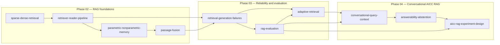

# Concept Map

## Reading Order

sparse-dense-retrieval → retriever-reader-pipeline → parametric-nonparametric-memory → passage-fusion → retrieval-generation-failures → rag-evaluation → adaptive-retrieval → conversational-query-context → answerability-abstention → aicc-rag-experiment-design

## Boundaries

- retrieval accuracy vs answer accuracy: 올바른 문서를 찾은 것과 올바른 답을 생성한 것은 별도 사건이다.
- parametric memory vs non-parametric memory: 모델 가중치에 저장된 지식과 외부 인덱스에서 조회하는 지식을 구분한다.
- relevance vs faithfulness: 질문과 관련 있는 문서인지와 답변의 주장이 그 문서로 뒷받침되는지를 구분한다.
- long context vs retrieval: 긴 입력을 제공하는 것만으로 필요한 근거가 안정적으로 사용된다고 가정하지 않는다.
- abstention vs human handoff: 답변을 보류하는 판단과 상담사에게 필요한 맥락을 전달하는 절차는 별도 평가 대상이다.
